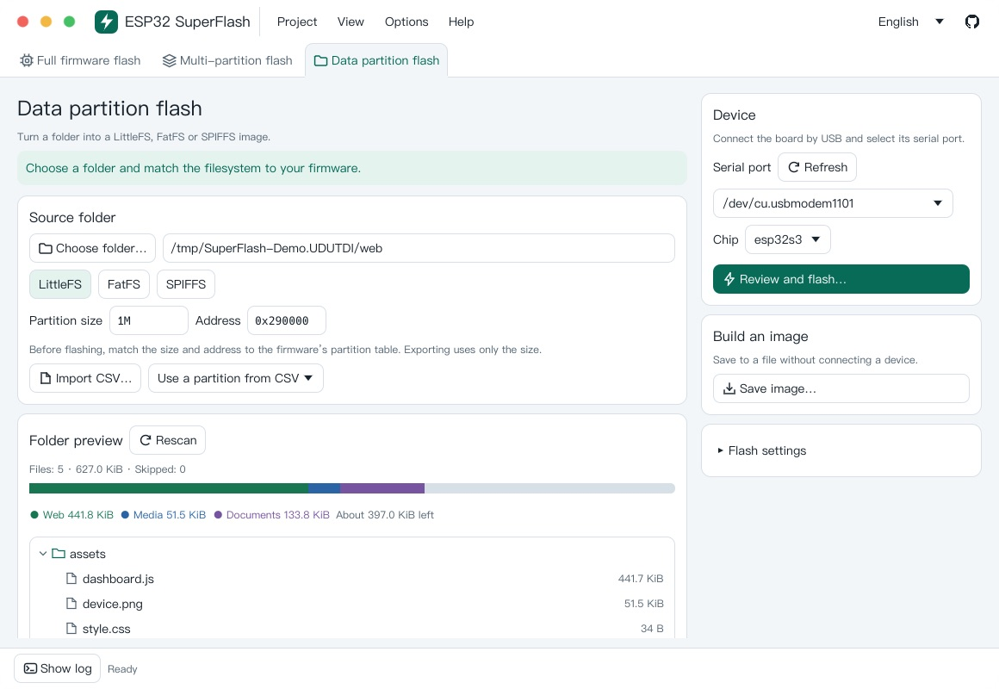

# ESP32 SuperFlash

[简体中文](README.zh-CN.md)

ESP32 SuperFlash is a desktop tool for flashing ESP32 firmware and data partitions. It uses Rust and egui and bundles the tools needed to build images and flash them offline.

*Data partition mode on macOS with a sample LittleFS folder.*

## Workbench

Use the tabs to switch between full firmware, multiple partitions, and data partitions. The app restores your files, addresses, serial port, and other settings when you reopen it. Open or export a workspace from **Project**. Show the resizable log from **View**. Toggle tips and advanced settings independently in **Options**, where you can also choose a light or dark appearance or follow the system.

The first launch uses the system language. The language picker beside the GitHub icon is always visible, and each choice is displayed in its own language. The interface supports English, Simplified Chinese, Traditional Chinese, Japanese, French, German, Russian, Spanish, Brazilian Portuguese, and Korean. It uses system fonts where available and includes Noto Sans CJK fallback fonts. Tool logs and help appear in the language supplied by the tool.

## Flashing modes

| Mode | What it does |
| --- | --- |
| Full firmware | Write a single, already merged raw binary. The default start address is `0x000000`. |
| Multiple partitions | Import a UTF-8 `partition.csv` or enter addresses manually. Assign a `.bin` to each partition you want to write, or export the selected images as a merged RAW, Intel HEX, or UF2 file. |
| Data partition | Choose a folder and a filesystem (LittleFS, FatFS, or SPIFFS), then enter the partition capacity and address. Preview the file tree and estimated usage before exporting an image or flashing it directly. |

Select the serial port, chip, baud rate, and flash settings in the device panel. Baud rate accepts both typed values and presets. The confirmation dialog shows the target and write ranges. During flashing you can copy the log, stop the operation, or hide the dialog and track progress in the status bar. Stopping a write can leave the affected flash region partially written.

Blank CSV offsets are resolved using ESP-IDF alignment rules. The default partition table offset is `0x8000`. Enter the actual offset if the firmware uses a different `CONFIG_PARTITION_TABLE_OFFSET`. With automatic chip detection, a CSV containing `bootloader/primary` also needs an explicit primary bootloader offset. You can add binaries absent from the CSV, such as the bootloader or partition table. Reimporting keeps manual rows and file assignments whose partition name and offset still match.

Choose a specific chip before merging. A raw merge starts at `0x000000` by default and fills gaps with `0xFF`. If you use `--target-offset`, use the same offset when flashing that merged binary. The partition table accepts raw binary inputs. HEX and UF2 exports are for tools that support those formats.

Enable **Advanced options** for command previews and extra esptool parameters. Enter one argument or value per line so paths can include spaces. The partition table supports per-file encryption, and the device panel supports encrypting the entire write. Data partition mode preserves the firmware image header settings and blocks full-chip erase.

## Filesystem settings

- **LittleFS** includes mklittlefs 4.0.2 (LittleFS 2.9.3) and 4.1.0 (LittleFS 2.11.1). Check the firmware's Arduino platform, `dependencies.lock`, `idf_component.yml`, or LittleFS submodule for the component version. You can select a custom mklittlefs executable and set the block and page sizes to match the firmware.
- **FatFS** uses ESP-IDF's generators for raw and wear-levelled images. Match the firmware's sector size, 512-byte safety or performance mode, and long filename settings. Raw FAT is for the firmware's read-only raw partition mount.
- **SPIFFS** uses ESP-IDF's `spiffsgen.py` with the chosen page size, object-name length, metadata length, magic flags, and index alignment. SPIFFS encodes directories as filename prefixes and skips empty directories.
- The preview skips symbolic links and special files. It can also omit system files. LittleFS and SPIFFS omit empty directories. With FatFS long names disabled, the preview shows the uppercase 8.3 names. The usage bar counts source bytes. Building the image checks whether the files fit once filesystem overhead is included.

The workspace is saved locally. Exporting it from **Project** produces a JSON file with paths and settings. After moving a project to another computer, update any file paths and the serial port.

## Build and package

Copy the whole `ESP32-SuperFlash` folder to the target machine, including `tools`. Install Rust 1.88 or later and [uv](https://docs.astral.sh/uv/getting-started/installation/). The scripts package the matching platform's tools and shared assets.

| Platform | Command | Output |
| --- | --- | --- |
| macOS Apple Silicon or Intel | `./scripts/package-macos.sh` | `dist/ESP32-SuperFlash.app` and a DMG |
| Windows x64 | `powershell -ExecutionPolicy Bypass -File scripts/package-windows.ps1` | Portable ZIP and setup EXE in `dist/` |
| Linux x64 or ARM64 | `./scripts/package-linux.sh` | tar.gz in `dist/` |

- **macOS** requires macOS 14 or later and the Xcode Command Line Tools to build. The package script applies and verifies ad hoc signatures on the `.app`, the `.dmg`, and bundled Mach-O files without a valid signature. Public distribution through Gatekeeper requires Developer ID signing and notarization.
- **Windows** uses the x64 Rust MSVC toolchain and the Visual Studio C++ desktop build tools. `scripts/package-windows.ps1` produces a portable ZIP and a setup EXE. The setup EXE needs Inno Setup 6.5+ (`ISCC.exe`); pass it with `-ISCC <path>` or set `INNO_ISCC`, otherwise only the ZIP is produced. The installer offers English and Simplified Chinese, adds Start Menu and optional desktop shortcuts, and registers an uninstaller. Use `-SkipTools -SkipBuild` to repackage prepared tools and an existing release binary. Extract the ZIP and run `ESP32-SuperFlash.exe` for the portable version.
- **Linux** builds on Ubuntu 22.04 or a newer target system. On Ubuntu, install `build-essential pkg-config libudev-dev libxkbcommon-dev libgl1-mesa-dev fontconfig`. The desktop needs X11 or Wayland, OpenGL, and a working XDG Desktop Portal for file dialogs. Set serial port permissions for your distribution, such as membership in Ubuntu's `dialout` group. Extract the archive and run `./ESP32-SuperFlash` with its sibling `tools` directory.
- Use `cargo run --locked` to run the development build after preparing the tools. To restore the pinned assets for all targets, run `uv run --python 3.12 --with-requirements scripts/build-requirements.txt python scripts/fetch-tools.py --all`. This downloads prebuilt release assets and prepares the shared image generator archive. The Apple Silicon build can also create its standalone `idf-image` helper locally.

## License and third-party notices

ESP32 SuperFlash is licensed under [GPL-3.0-only](LICENSE). The bundled components retain their upstream licenses:

| Bundled tool and source | Copyright / attribution | License |
| --- | --- | --- |
| [esptool 5.6.0](https://github.com/espressif/esptool/tree/v5.6.0) | Fredrik Ahlberg, Angus Gratton, Espressif Systems, and contributors | GPL-2.0-or-later |
| [mklittlefs 4.1.0 / 4.0.2](https://github.com/earlephilhower/mklittlefs/releases) and [LittleFS](https://github.com/littlefs-project/littlefs) | Ivan Grokhotkov; the littlefs authors and Arm Limited | MIT; BSD-3-Clause |
| [mkspiffs 0.2.3](https://github.com/igrr/mkspiffs/releases/tag/0.2.3) and [SPIFFS](https://github.com/pellepl/spiffs/tree/f5e26c4) | Ivan Grokhotkov; Peter Andersson | MIT |
| ESP-IDF 6.1 [FatFS](https://github.com/espressif/esp-idf/tree/v6.1/components/fatfs) and [SPIFFS](https://github.com/espressif/esp-idf/blob/v6.1/components/spiffs/spiffsgen.py) generators | Espressif Systems | Apache-2.0 |

See the [third-party notices](tools/README.md#third-party-notices-and-source-links) for runtimes, libraries, fonts, icons, and the locations of the license files in each package. The app also lists its main third-party notices under **Help → About**. If you distribute a package containing esptool, follow the corresponding-source requirements in its [GPL license](https://github.com/espressif/esptool/blob/v5.6.0/LICENSE).
