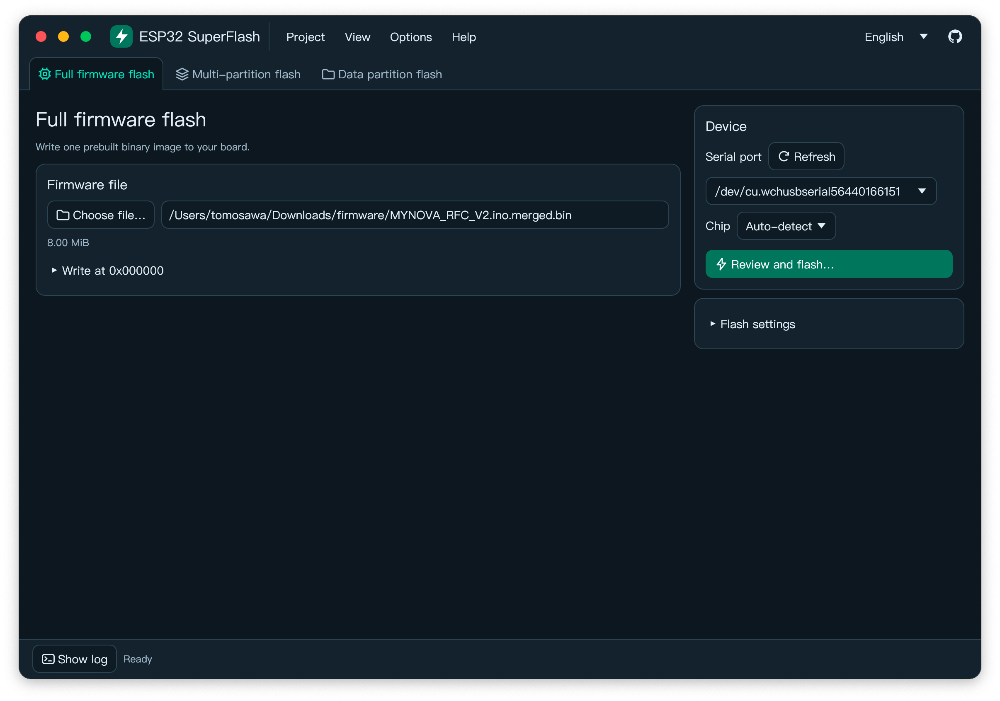
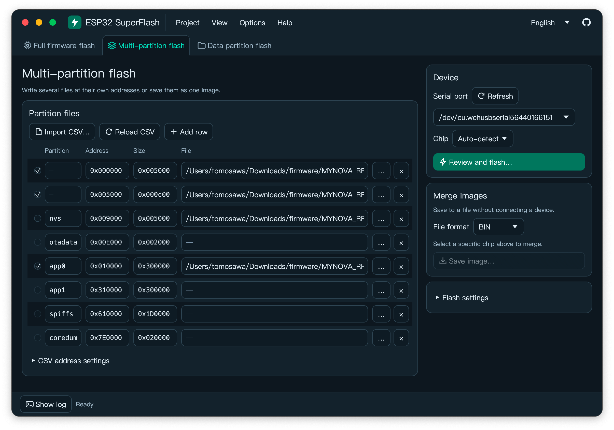
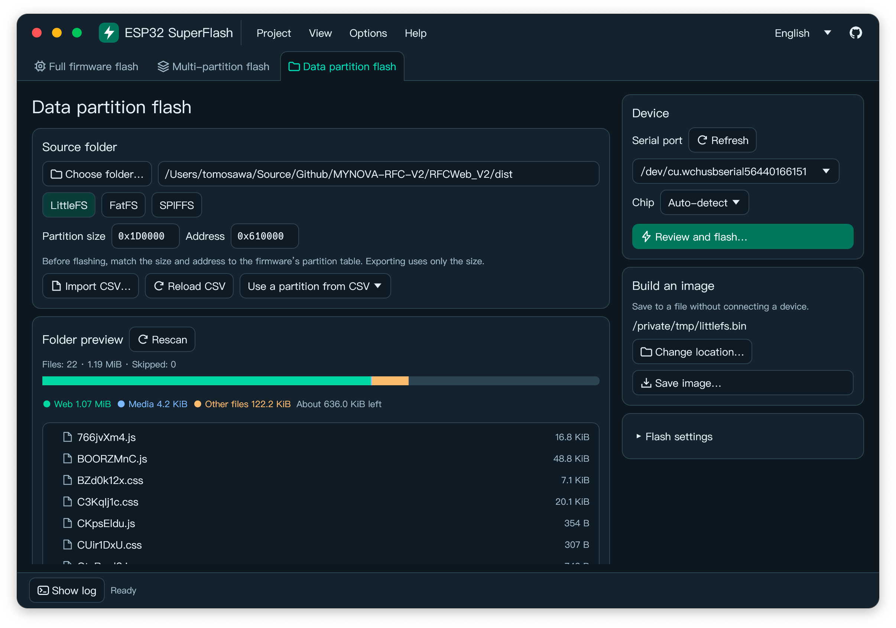

# ESP32 SuperFlash

English | [简体中文](README.zh-CN.md)

A desktop tool for flashing ESP32 firmware over serial and building LittleFS, FatFS, and SPIFFS images. The release packages include esptool and the image generators for offline use.

## Download and install

[Download from GitHub Releases](https://github.com/Tomosawa/ESP32-SuperFlash/releases) · Windows x64, macOS 14+ (Apple Silicon and Intel), Linux (x64 and ARM64)

- **Windows** — Run the installer or extract the portable ZIP and open `ESP32-SuperFlash.exe`.
- **macOS** — Open the DMG and drag SuperFlash to Applications.
- **Linux** — Extract the archive and run `./ESP32-SuperFlash`. Keep the `tools` directory beside it. If the app cannot open the serial port, check your user's permissions for that device.

## Flashing modes

### Full firmware

Flash a merged RAW binary. The default start address is `0x000000`.



### Multiple partitions

Import a UTF-8 `partition.csv` or enter addresses manually. Flash selected `.bin` files or export them as a merged RAW, Intel HEX, or UF2 image.



**Partition offsets.** Blank CSV offsets follow ESP-IDF alignment rules. The partition table defaults to `0x8000`. If the firmware sets a different `CONFIG_PARTITION_TABLE_OFFSET`, enter that value. A CSV with a `bootloader/primary` entry requires an explicit bootloader offset when the chip is set to Auto.

**Merged images.** Select the target chip before merging. If you set `--target-offset` for a RAW export, flash the image at the same address. HEX and UF2 are export formats.

### Data partition

Build a LittleFS, FatFS, or SPIFFS image from a local folder. Save the image or flash it directly.

Choose **Raw image** to write an existing image, such as a `.tar` your firmware reads directly. Use the size and offset of the target data partition.



**Filesystem images.** Use the partition size and offset from your firmware's partition table. Match the image settings to the firmware:

- **LittleFS** — Select 2.9.3 or 2.11.1, or supply your own `mklittlefs`. Match the block and page sizes.
- **FatFS** — Match the raw or wear-levelled layout, sector size, 512-byte safety or performance mode, and long filename support.
- **SPIFFS** — Match the page size, object name and metadata lengths, magic flags, and index alignment.

## Build from source

Install Rust 1.88+ and [uv](https://docs.astral.sh/uv/getting-started/installation/). Run these commands from the repository root:

```sh
uv run --python 3.12 --with-requirements scripts/build-requirements.txt python scripts/fetch-tools.py
cargo run --locked
```

Run the packaging script on the target platform. Packages go to `dist/`.

| Platform | Command | Build dependencies |
| --- | --- | --- |
| macOS | `./scripts/package-macos.sh` | Xcode Command Line Tools |
| Windows | `powershell -ExecutionPolicy Bypass -File scripts/package-windows.ps1` | Rust MSVC toolchain and Visual Studio C++ Build Tools. Inno Setup 6.5+ for the optional installer. |
| Linux | `./scripts/package-linux.sh` | On Ubuntu 22.04+: `build-essential pkg-config libudev-dev libxkbcommon-dev libgl1-mesa-dev fontconfig` |

## Issues and contributions

For a flashing problem, include your SuperFlash version, OS, ESP32 variant, and error log when [opening an issue](https://github.com/Tomosawa/ESP32-SuperFlash/issues).

Open a pull request to contribute a fix or improvement.

## License

[GPL-3.0-only](LICENSE). See [bundled tools and third-party notices](tools/README.md) for component versions, licenses, and source links.
