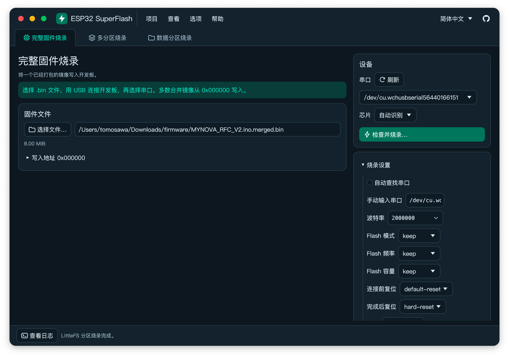
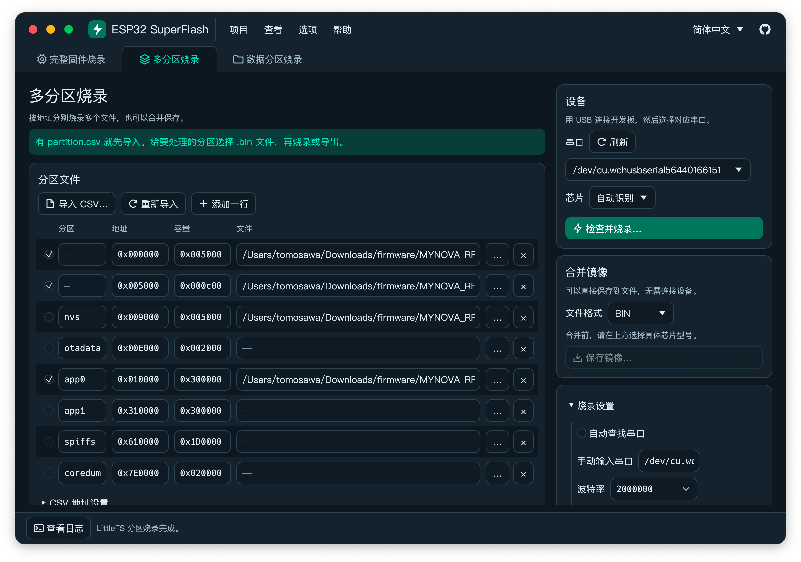
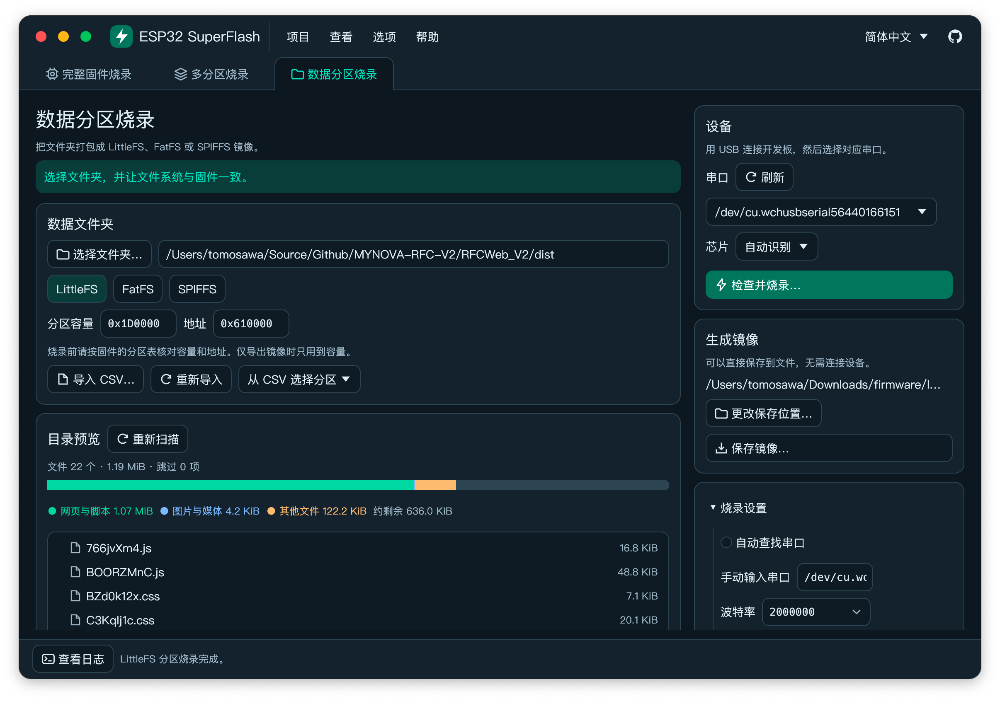

# ESP32 SuperFlash

[English](README.md) | 简体中文

ESP32 固件烧录工作台。使用 Rust、egui 和原生窗口，随应用分发 Espressif esptool 和文件系统生成器。打包后的应用可离线运行。

## 工作台

顶部可直接切换「完整固件烧录」「多分区烧录」和「数据分区烧录」。文件、地址、串口和其他参数会自动恢复，下次打开即可继续使用。「项目」菜单可打开或另存工作区。操作提示和高级选项可以独立开关。外观默认跟随系统，也可手动切换亮色或暗色。

首次启动按系统语言显示，点击右上角 GitHub 图标左侧的语言框可切换简体中文、繁体中文、英语、日语、法语、德语、俄语、西班牙语、巴西葡萄牙语和韩语。应用会记住语言和界面选项。macOS 优先使用系统苹方，Windows 优先使用微软雅黑，Linux 从 Fontconfig 读取当前语言的系统无衬线字体。日文、韩文及繁体字使用相应的系统字形或随包的开源后备字体。工具日志和原始帮助使用上游工具输出的语言。

## 三种工作模式

| 模式 | 操作 |
| --- | --- |
| 完整固件烧录 | 选择一个已经合并好的 RAW 二进制镜像。烧录地址默认 `0x000000`，可修改。 |
| 多分区烧录 | 导入 UTF-8 的 `partition.csv` 或手动添加地址，选择并启用对应的 `.bin` 文件。可分别烧录，或合并并保存 RAW、Intel HEX、UF2。 |
| 数据分区烧录 | 选择 LittleFS、FatFS 或 SPIFFS 及数据文件夹，填写偏移和容量。检查目录树和容量条后，可以只生成镜像，也可以生成后直接烧录。 |

在右侧选择串口、芯片、波特率和 Flash 参数。可预览命令，开始烧录前会列出目标及写入范围。确认烧录后，烧录信息窗口会显示实时日志和可用的进度，并保留最终结果。窗口内可复制日志或停止操作。波特率可在同一个控件内直接输入或选预设。停止写入时，Flash 中可能保留部分数据。

CSV 留空偏移按 ESP-IDF 规则推算，默认分区表偏移为 `0x8000`。如果工程修改了 `CONFIG_PARTITION_TABLE_OFFSET`，先在 CSV 地址设置填写实际值。自动识别芯片时，带 `bootloader/primary` 的 CSV 需要显式提供主 Bootloader 偏移。普通 CSV 只包含应用和数据分区，可以手动补充 Bootloader、分区表二进制和其他镜像。重新导入会更新 CSV 的行，并保留手动行及名称、地址均匹配的文件选择。

合并前选定具体芯片。RAW 合并默认保留从 `0x000000` 开始的空洞，用 `0xFF` 填充。如果使用高级选项指定 `--target-offset`，烧录合并后的 RAW 时填写同一偏移。烧录表格接收 RAW 镜像。HEX、UF2 导出用于支持相应格式的工具。

开启「高级选项」后，可在「更多 esptool 参数」中选择全局、烧录和合并参数。每行一个参数或参数值，含空格的路径直接放在一行。多分区表格中的「加密」对应按文件加密，全局「烧录时加密」对应所有文件。点「官方帮助」可查看当前内置二进制的选项说明。数据分区模式保持固件镜像头设置，并拦截整片擦除。

## 文件系统兼容性

- **LittleFS** 内置 mklittlefs 4.0.2（LittleFS 2.9.3）和 4.1.0（LittleFS 2.11.1）。检查固件的 Arduino 平台包、`dependencies.lock`、`idf_component.yml` 或 LittleFS 子模块来确定组件版本。ESP-IDF 版本本身无法确定应用选用的 LittleFS 版本。需要其他版本或定制构建时可指定外部 mklittlefs，并填写固件使用的块、页大小。
- **FatFS** 使用 ESP-IDF 官方生成器初始化卷和磨损均衡布局，并支持 Unicode 长文件名。匹配固件的 `CONFIG_WL_SECTOR_SIZE`、512 B 安全/性能模式及长文件名选项。裸 FAT 适用于固件的只读原始分区挂载接口。
- **SPIFFS** 使用 ESP-IDF 的 `spiffsgen.py`。请匹配 `CONFIG_SPIFFS_PAGE_SIZE`、`CONFIG_SPIFFS_OBJ_NAME_LEN`、`CONFIG_SPIFFS_META_LENGTH`、Magic 和索引对齐设置。SPIFFS 通过文件名前缀表示目录，空目录会跳过。
- 目录预览会跳过符号链接和特殊文件，可选择排除系统文件。LittleFS 与 SPIFFS 镜像会略过空目录。关闭 FatFS 长文件名时，预览会显示实际使用的大写 8.3 名称。容量条按源文件字节分类统计，剩余数值未扣除文件系统元数据、磨损均衡或块分配。可点击「生成并保存」检查真实镜像能否装入分区。

所选文件和目录、分区表、工具参数及输出位置会自动保存到本机应用配置目录。「保存项目」可导出 JSON，「打开项目」可复用已保存的设置。项目文件记录路径，跨机器复制后请按新位置重新选择文件和串口。

## 在对应平台打包

将整个 `ESP32-SuperFlash` 目录连同 `tools` 复制到目标平台，安装 Rust 1.88 或更新版本和 [uv](https://docs.astral.sh/uv/getting-started/installation/)。工具准备脚本通过 uv 使用 Python 3.12，发布包可离线运行。可给工具准备脚本加上 `--all`，恢复所有目标平台的预编译资源。详细清单见 [随应用分发的工具](tools/README.md)。

| 平台 | 命令 | 产物 |
| --- | --- | --- |
| macOS arm64 / Intel | `./scripts/package-macos.sh` | `dist/ESP32-SuperFlash.app` 与 `.dmg` |
| Windows x64 | `powershell -ExecutionPolicy Bypass -File scripts/package-windows.ps1` | `dist/ESP32-SuperFlash-版本-windows-x86_64.zip` 与 `...-setup.exe` |
| Linux x86_64 / aarch64 | `./scripts/package-linux.sh` | `dist/ESP32-SuperFlash-版本-linux-架构.tar.gz` |

- macOS 产物需要 macOS 14 或更新系统，构建需要 Xcode 命令行工具。打包脚本对 `.app`、`.dmg` 和没有有效签名的内置 Mach-O 文件执行 Ad-hoc 签名并校验。通过 Gatekeeper 对外分发需要使用 Developer ID 签名并进行公证。
- Windows 使用 x64 Rust MSVC 工具链和 Visual Studio Build Tools 的 C++ 桌面开发组件。`scripts/package-windows.ps1` 同时生成便携版 ZIP 与安装包 EXE。安装包需要 Inno Setup 6.5+ 的 `ISCC.exe`，可通过 `-ISCC <路径>` 参数或 `INNO_ISCC` 环境变量指定；未找到时只生成 ZIP。安装包提供中英文界面、开始菜单与可选桌面快捷方式，并注册卸载程序。工具和 Release 可执行文件已就绪时，可加 `-SkipTools -SkipBuild` 只重新打包。便携版完整解压后运行 `ESP32-SuperFlash.exe`。
- Linux 建议在 Ubuntu 22.04 或更新的目标系统打包。Ubuntu 构建依赖可用 `sudo apt install build-essential pkg-config libudev-dev libxkbcommon-dev libgl1-mesa-dev fontconfig` 安装。桌面需要 X11 或 Wayland、OpenGL 和可用的 XDG Desktop Portal 文件对话框。串口访问权限按发行版配置，例如 Ubuntu 的 `dialout` 组。解压后运行 `./ESP32-SuperFlash`，保留同级的 `tools`。
- 首次准备后可用 `cargo run --locked` 启动开发版。每个包只复制本机对应的工具目录和共享字体。

## 许可证与第三方版权说明

ESP32 SuperFlash 使用 [GPL-3.0-only](LICENSE)。随应用分发的第三方组件保留各自的上游许可证：

| 内置工具与上游源码 | 版权归属 | 许可证 |
| --- | --- | --- |
| [esptool 5.6.0](https://github.com/espressif/esptool/tree/v5.6.0) | Fredrik Ahlberg、Angus Gratton、乐鑫科技及其他贡献者 | GPL-2.0-or-later |
| [mklittlefs 4.1.0 / 4.0.2](https://github.com/earlephilhower/mklittlefs/releases) 和 [LittleFS](https://github.com/littlefs-project/littlefs) | Ivan Grokhotkov；LittleFS 作者和 Arm Limited | MIT；BSD-3-Clause |
| [mkspiffs 0.2.3](https://github.com/igrr/mkspiffs/releases/tag/0.2.3) 和 [SPIFFS](https://github.com/pellepl/spiffs/tree/f5e26c4) | Ivan Grokhotkov；Peter Andersson | MIT |
| ESP-IDF 6.1 [FatFS](https://github.com/espressif/esp-idf/tree/v6.1/components/fatfs) 和 [SPIFFS](https://github.com/espressif/esp-idf/blob/v6.1/components/spiffs/spiffsgen.py) 生成器 | 乐鑫科技 | Apache-2.0 |

[第三方版权清单](tools/README.md#third-party-notices-and-source-links)还列出运行时、库、字体、图标以及发布包内的许可文件位置。软件中可在「帮助 → 关于」查看主要组件的版权说明和来源。发布含 esptool 的包时，需按其 [GPL 许可证](https://github.com/espressif/esptool/blob/v5.6.0/LICENSE)的要求提供对应源码。
